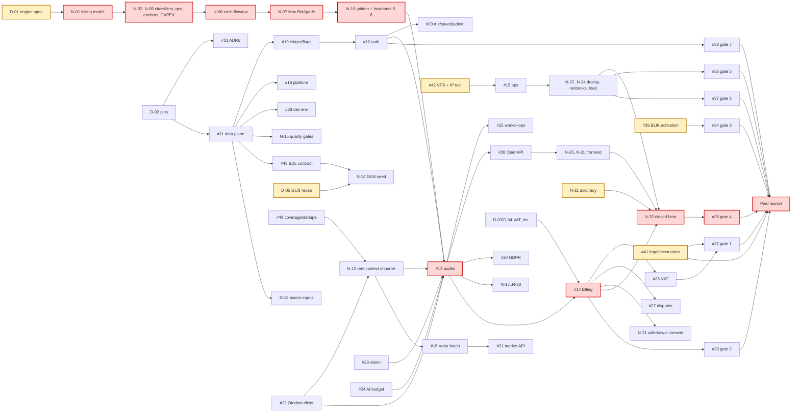

# Roadmap — greenfield rebuild to paid launch

**Planning baseline:** 2026-10-11 · **Revision:** 2 (audit of revision 1, RM-47) · **Status:** plan, not a commitment.
`[C]` = confirmed in the cited file, issue or vendor page; `[I]` = planning inference to verify.
Every effort figure is an **estimate** in agent-days (one agent, one ticket, offline tests, no vendor outage), excluding
owner wait and review time. `N-xx` = proposed issue not created yet (see *Proposed issues*); `D-xx` = owner decision.

## 0. What changed from revision 1, and why

| Revision 1 | Problem | Revision 2 |
|---|---|---|
| Market data (#16) last, after billing and ops | Audits need rental sidecars, hedonic anchors and deed/asking context at the `context`/`anchors` stages (Blueprint §2 pipeline) [C]; ADR 0001 dropped the corpus importers of §4.8 step 2 [C] → no real valuation before M8 | **M3 market-context lane** runs parallel to M1–M5; radar/screener stay late (M10) |
| #44 frontend between billing and ops on the critical path | Ops does not depend on the SPA; a paid launch does need a UI [I] | Ops (M7) and frontend (M8) run in parallel; frontend is **launch-required** |
| No beta | L-003 needs two weeks of measured COGS; gate 4 needs 20 representative audits [C] | **M9 closed beta** on production before charging |
| #17 engine = 1 ticket, 3–6 days | POC engine ≈ 141 files / 23.8k LOC (CONTEXT §4.1) [C] | Engine split into N-01…N-11 (15–28 days) |
| #44 SPA = 1 ticket, 6–10 days | ~10 screens, auth, paywall, legal pages, pl/en | Split into N-25…N-31 (15–25 days) |
| #13 also builds the fetcher | Duplicates #22 → parallel-run file conflict | #13 consumes #22's client only |
| #43 bundles six decisions | Engine spec waits on VAT display | Split into D-01…D-12 with **calendar dates** |
| Owner GUS suggestion dismissed as `[I]` | ADR 0001 covers only `otodom-rent-report`, not `gus-stats-poc` [C] | Explicit decision **D-05** with a recommendation |
| No calendar, totals, run sizing, file ownership, priorities | Not executable by agents capped at 40 turns / 30 min per run (AUTONOMY.md) [C] | §3 calendar, §5 run-sizing rule, §6 file-ownership matrix, §9.1 order and P0–P2 for every ticket |
| Invariants "four" | `agents.md` §1 lists 6; blueprint §4.6 tests only 4 [C] | N-10 adds named tests for invariants 5 and 6 |

## 1. Guardrails

- [C] Greenfield, production bar; the Otodom POC is read-only requirements and defect evidence (ADR 0001, `poc-reference.md`).
- [C] Phase 1 = backend (§4.8 steps 1–5, 7, 8). Step 6 frontend is Phase 2 but **required for a paid launch** [I].
- [C] "Do not start step N+1 with step N red" (`agents.md` §7). **D-10** asks whether *not started* (engine blocked on the spec)
  counts as red; until answered, M2 waits for M1 and the whole plan waits for D-01.
- [C] `invariants`/`migrations` CI stay red until real tests exist; never stub them (CONTEXT §8).
- [C] Every money, auth, webhook, migration-contract or invariant PR waits for a human comment (`pull-requests.md`).

## 2. Calendar constraints (hard dates)

| Date | Constraint | Source | Affects |
|---|---|---|---|
| 2026-10-31 | Stripe MCP requires Agent-tagged keys | TOOLCHAIN §Sources [C] | #40, agent Stripe tooling |
| ≈ 2026-11-27 | OVH Black Friday window; promo may not apply to an existing VPS | Blueprint §1/§5 [C]; date [I] | #42, D-09 |
| 2027-01-01 | KSeF penalties start for B2B | PRE-DEPLOYMENT §4, Blueprint §5 [C] | #26, #32, #41 |
| Launch − 2 weeks | Pro allowance from measured COGS (L-003) | Blueprint §5 [C] | M9 beta length |
| Launch − 1 week | Google OAuth consent screen "In production" | Blueprint §5 [C] | #40 |

## 3. Effort and calendar (estimate)

| Milestone | Agent-days | Lane |
|---|---|---|
| M0 Decisions and long poles | 1–2 | owner |
| M1 Engine | 15–28 | A |
| M2 Data plane and platform | 8–14 | B |
| M3 Market context for audits | 8–15 | C |
| M4 Identity and tenancy | 4–7 | B |
| M5 Audit pipeline | 14–24 | B |
| M6 Billing and tax | 10–18 | B |
| M7 Ops and deploy | 8–14 | D |
| M8 Frontend (Phase 2) | 15–25 | E |
| M9 Closed beta | 2–4 (+ 2–4 weeks elapsed) | all |
| M10 Radar and screener | 10–18 | C |
| M11 Gates and paid launch | 3–6 | owner + D |
| **Total** | **98–175** | |

**Critical path** (§7 graph): D-01 → M1 → M5 → M6 → M9 → M11 ≈ **45–82 agent-days + 2–4 weeks beta + owner latency**.
Assumptions [I]: up to 3 concurrent agent lanes; owner reviews ≤ 2 business days per gated PR; ~25 gated PRs means
the owner's review time (≈ 1 h each) is itself a long pole. With one lane and serial review, expect roughly the total, not the path.

## 4. Milestones

Each milestone: goal · issues · first `agent` ticket · human gates · exit evidence · CI switch · risk.
Ticket-level order and priority: §9.1.

### M0 — Decisions and long poles started
- **Issues:** #31, #39, #40, #41, #42, D-01…D-12 (split of #43). **First agent:** #31 once D-02 is answered.
- **Gates:** owner only. **Exit:** D-01, D-02, D-05, D-10 answered in their issues; BLIK request sent (#39); counsel and accountant
  engaged, Fakturownia trial opened (#41); Stripe Agent keys (#40) by 2026-10-31; VPS order date fixed (#42).
- **CI:** none. **Risk:** an unanswered D-01 stalls Lane A and, under D-10's strict reading, Lane B.

### M1 — Engine (`apps/deal_analyzer`), lane A
- **Issues:** #17 (umbrella) → N-01…N-11. **First agent:** N-01 after D-01. Serial: N-01 → (N-02, N-03, N-04, N-05 parallel) →
  N-06 → N-07; N-08, N-09 after N-01; N-10 last; N-11 needs owner-labelled listings.
- **Gates:** owner validates each formula PR against the written spec (no POC transcription).
- **Exit:** `test_invariant_rent_is_not_a_deal`, `…_admin_fee_is_opex`, `…_deterministic_math`, new `…_fractional_ownership_rejected`,
  `…_json_is_canonical`; golden snapshots; hypothesis tests on cash flow/Max Bid monotonicity; `Decimal` end to end; semgrep
  `no-float-money` active on `apps/` (N-15).
- **CI:** none yet (fourth invariant arrives in M2). **Risk:** wrong financial semantics; mitigated by spec-first and N-11.

### M2 — Data plane and platform, lane B
- **Issues:** #11 → #19; #18, #29, N-15 parallel after #11's models merge. **First agent:** #11 (after D-02; D-10 if M1 not green).
- **Rule:** #11 creates **every** blueprint §3 table in the baseline so later tickets rarely touch `models.py`; afterwards only one
  open migration PR at a time (single Alembic head).
- **Exit:** Testcontainers PG17, Alembic baseline, Procrastinate schema, `test_invariant_asking_is_not_deed`, `tests/migrations`,
  squawk, RFC 9457 shape, `/healthz` `/readyz`, ledger property and concurrency tests (#19, human review).
- **CI switch:** last green M2 PR → owner sets `ENABLE_INVARIANTS_JOB=true`, `ENABLE_MIGRATIONS_JOB=true`, re-adds both as required
  on `staging` (PRE-DEPLOYMENT §1). Fix #17's body, which says this happens at M1.

### M3 — Market context for audits, lane C (parallel to M1–M5)
- **Issues:** #48, #49, N-12, N-13, N-14. **First agent:** N-12 (macro sources) after #11; N-13 after #22's client contract and #49;
  N-14 after D-05 and #48.
- **Exit:** `ContextRepository` (Postgres) serves rent sidecars for the beta city set, BDL metrics with provenance, risk-free rate;
  coverage manifest per city; asking/deed typed separately; checkpointed, resumable imports; fixtures recreated, never copied.
- **Risk:** Otodom volume at 1 req/s shared with audits (727 cities × rent + sale × pages ≈ hours per sweep [I]); start with the
  beta city set (D-11). GUS quota; mitigated by D-05 seed.

### M4 — Identity and tenancy, lane B
- **Issues:** #12 → #20. **First agent:** #12. **Gates:** human review (auth).
- **Exit:** the six auth/tenant tests of §4.6 (`test_google_token_validation`, `…_signup_gets_credits`, `…_links_existing_email`,
  `…_unverified_rejected`, `test_tenant_isolation`, Origin check); NOTIFY revocation; admin adjustment idempotent. Gate 7 runnable (#38).

### M5 — Audit pipeline, lane B
- **Issues:** #22, #23, #24 (parallel) → #13 → #25, #28, #30, N-17, N-18, N-19, N-20. **First agent:** #22. **Gates:** #13, #24 (money).
- **Exit:** `test_quota_race`, `test_duplicate_active_audit`, `test_failed_audit_releases`, `test_sse_resume`,
  `test_sse_burst_listener_survives`, `test_engine_timeout_kills_child`, `test_worker_death_releases_credit`; AI-budget atomic
  reservation; kill-switch flags per `LegalTag` tested off/on (N-20); audit stores model, prompt version and vision outputs (N-18);
  submit rate limit and free-credit abuse policy (N-17); OpenAPI committed and schemathesis green (#28).
- **Risk:** Otodom drift/block, OpenRouter cost, OOM. Designed out: Postgres state, child deadline + `RLIMIT_AS`, short transactions.

### M6 — Billing and tax, lane B
- **Issues:** #14 → #26, #27, N-21. #32, #33 run as evidence after. **First agent:** #14 after D-03 and D-04. **Gates:** every PR.
- **Exit:** all webhook/pass tests of §4.6 incl. `test_webhook_concurrent_duplicate`, `test_subscription_events_adverse_order`,
  `test_pass_parallel_stacks`, `test_has_pro_fails_closed`, `test_vat_invoice_idempotent`; test-clock run; withdrawal-right
  consent captured at Checkout (N-21, counsel-confirmed). Gate 2 evidence (#33).
- **Risk:** BLIK recurring not activated (#39) → card + pass still sell; Fakturownia `oid` lookup undocumented → confirm on trial.

### M7 — Ops and deploy, lane D (parallel to M6/M8 once #42 delivers a VPS)
- **Issues:** #15, N-22, N-23, N-24, #42 (owner). **First agent:** #15.
- **Exit:** compose limits per resource matrix, Caddy (CSP, HSTS, internal health blocked), host hardening, WAL-G + nightly dump to
  R2 (14 d / 56 d), monitors triggered once each (#25), CI-built SHA-tagged images and rollback (N-22), six runbooks (N-23),
  load harness (N-24). Gates 5 and 6 evidence (#36, #37). Datacenter-IP result recorded in L-002.

### M8 — Frontend (Phase 2), lane E
- **Issues:** #44 (umbrella) → N-25 … N-31. **First agent:** N-25 after #28 publishes OpenAPI and D-06 is answered.
- **Exit:** `tsc` on the generated client, `test_no_frontend_finance`, SSE reconnect, 402 paywall with BLIK bank list, account
  export/delete, legal pages and cookie notice, pl/en, keyboard/contrast accessibility pass.
- **Gates:** owner on copy, BLIK disclosure, legal pages. **Risk:** finance logic creeping into TS (POC audit §2.1).

### M9 — Closed beta on production (free, invite-only)
- **Issues:** N-32, #35 (gate 4). **Entry:** M5, M7 and N-25/N-26 green; D-11 (beta size, cities).
- **Exit:** ≥ 2 weeks of per-audit tokens/USD → allowance proposal (L-003 resolved or superseded); gate 4 memory evidence; N-11
  accuracy report accepted by owner; no `UPSTREAM_SCHEMA_DRIFT` unresolved; Better Stack error budget agreed.

### M10 — Radar and screener, lane C (may follow launch if D-12 narrows scope)
- **Issues:** #16 → #21. **Exit:** 727-city ranking with withheld partial cohorts (#48), screener approval queue behind `screener`
  flag, free tier sees top 20. Tags `LEGAL[scraping|third-party-data|republication]`.

### M11 — Gates and paid launch
- **Issues:** #32–#38, #41, #40. **Exit:** gates 1–7 evidence, PRE-DEPLOYMENT §0–§7 ticked with evidence, active limitations
  accepted or mitigated, live prices created, one human-approved `staging` → `main` PR, production smoke test.

## 5. Agent run-sizing rule

[C] A headless run is capped at 40 turns and 30 minutes (AUTONOMY.md). [I] A ticket is agent-ready only if it touches one module or
route group, adds at most one migration, and fits ≈ 400 changed lines; otherwise split it before labelling `agent`. Umbrella
issues (#17, #44) never get the label; their children do. Each child names its files (§6) so lanes do not collide.

## 6. Parallel lanes and file ownership

| Path | Owner ticket(s) | Rule |
|---|---|---|
| `apps/deal_analyzer/**` | N-01…N-11 | One submodule per ticket; `model.py` (types) owned by N-01, then append-only |
| `packages/rm-core/.../db/models.py`, `migrations/` | #11, then serial | Single Alembic head; one open migration PR |
| `packages/rm-core/.../ledger.py`, `entitlements.py`, `flags.py` | #19 (N-20 extends flags) | Serial |
| `packages/rm-contracts/.../problems.py` | any | Append-only; rebase on conflict |
| `services/api/.../auth/**` | #12 | — |
| `services/api/.../routers/{audits,me,saved,admin,billing,market,screener}.py` | #13, #20, #14, #21 | Disjoint |
| `services/worker/.../clients/{otodom,openrouter,geo,fakturownia,resend}.py` | #22, #23, N-03, #26, #25 | Disjoint |
| `services/worker/.../tasks/**` | #13, #25, #26, #30, #16, N-13, N-14 | One file per task family |
| `deploy/**` | #15, N-22 | Serial |
| `frontend/**` | N-25…N-31 | One route folder per ticket; `api/` generated only |

Lanes: **A** engine · **B** platform (M2 → M4 → M5 → M6) · **C** market (M3 → M10) · **D** ops (M7) · **E** frontend (M8).
Integration points: #13 needs A (engine entry point), C (context repository) and #22/#23; M9 needs B, D, E.

## 7. Dependency graph

Red = critical path. Amber = long poles: engine spec, BLIK activation, legal/accountant + Fakturownia/KSeF trial, VPS/IP test,
GUS reuse decision, owner-labelled accuracy set.

## 8. Owner decisions (split of #43) — by date

| ID | By | Decision | Blocks | Recommendation |
|---|---|---|---|---|
| D-01 | 2026-10-25 | **Engine spec** (questions below) | M1, critical path | Answer in #43 in one pass; agents implement section by section |
| D-02 | 2026-10-18 | SQLAlchemy 2.0 vs 2.1; Stripe SDK major + API version | #11, #31, #14 | 2.1 pinned minor; SDK whose default is `2026-09-30.endive` (TOOLCHAIN §8) |
| D-03 | 2026-11-30 | VAT presentation of 100 zł (gross B2C vs net B2B) | #14 prices | Accountant (#41) first |
| D-04 | 2026-11-30 | Free tier scope; initial Pro allowance | #14, #19 seed | 3 audits + radar top 20; allowance set after M9 |
| D-05 | 2026-10-25 | Reuse `gus-stats-poc` data? | N-14 | One-time seed from its **raw BDL `observations.jsonl`** through #48's validated importer with source provenance, then API refresh; never its derived `web/data` export. Its README says not production-ready until its REVIEW_ROADMAP closes [C] |
| D-06 | 2026-11-15 | Frontend: greenfield vs blueprint "keep the existing SPA" (conflicts with ADR 0001) | M8 | Greenfield, POC UI as design reference; ADR 0002 |
| D-07 | 2026-11-01 | Ship `analyst`, seller-questions, redesign in Phase 1? | #13 contract | Drop `analyst` from `AuditCreate` until scheduled; flags stay |
| D-08 | 2026-11-15 | Deed data at launch (BDL only, or Cenogram too) | N-14, #16 | BDL only; Cenogram after launch |
| D-09 | 2026-11-20 | VPS: order Black Friday promo vs commit later | #42, M7 | Order new promo VPS in window; IP test same week |
| D-10 | 2026-10-18 | May lanes B/C start while M1 is blocked on the spec? | M2–M5 | Yes: "not started" ≠ "red"; record in an ADR |
| D-11 | 2026-11-15 | Beta: size, cities, duration | M3 scope, M9 | 20–50 invitees, 10–20 cities, 2–4 weeks |
| D-12 | 2026-12-01 | Is the radar/screener launch scope or post-launch? | M10, M11 | Radar top-N at launch; screener post-launch |

**D-01 engine questions** (POC behaviour listed as *requirements to confirm*, never as formulas to copy):
1. Horizon(s): POC offered 10 years plus 5/15/20 views [C, POC `apps/ARCHITECTURE.md`]. Which horizons, monthly or annual periods, start date?
2. Purchase costs: notary, PCC 2%, broker, court fees — which, and when VAT replaces PCC (VAT sale / non-residential classifier)?
3. Operating costs: admin fee (OPEX, invariant 3), insurance, property tax, vacancy, management, maintenance reserve — defaults and sources?
4. CAPEX: catalog per m² and per item; regional multiplier (POC audit 3.1-4 found national constants misprice metros); vision-driven condition scale?
5. Rent: hedonic anchor vs comparables; thin-market policy (< N listings: shrink, widen interval, or refuse)? Rent growth and inflation, nominal or real?
6. Tax: ryczałt 8.5%/12.5% thresholds, other regimes, capital-gains on exit, who is the taxpayer (individual only)?
7. Financing: cash only (POC) or LTV/rate/tenure model (POC audit 3.1-5: most buyers leverage)? If yes, which rate source?
8. Exit: terminal value method(s) (POC kept market and income views separate), exit cap, selling costs?
9. Discount/hurdle: risk-free source (POC used Eurostat PL 10Y with a 1–2 month lag, L-20) plus premium?
10. **Max Bid:** the highest price meeting which target (IRR, yield, MOIC) at which horizon, including or excluding CAPEX and costs?
11. Grades: names, metric(s), cut-offs, and the "insufficient data" grade.
12. LLM: which adjustments may the LLM propose (condition, CAPEX items, rent), clamp ±15% of what base, and which model?
13. Rounding: currency precision per field and rounding mode for display vs computation.

## 9. Ticket register: execution order, priority and proposed issues

### 9.1 Execution order and priority (all open issues, proposed tickets and decisions)

Generated from the dependency list behind §7 and checked mechanically: every ticket appears once, every open GitHub issue is
present, each dependency sits in an earlier wave, and no ticket outranks what it waits on (a dependency inherits the priority
of the most urgent ticket that needs it).

- **Wave (W0–W11):** earliest start; everything in one wave can run concurrently in separate agent runs, subject to §6. The `#`
  column is the recommended pick order: lower wave first, then higher priority.
- **P0** — on the path to a paid launch; any slip moves the launch date. Work these first within a wave.
- **P1** — required for launch, but has slack; pick when no P0 in the wave is free.
- **P2** — can ship after launch or is optional. ¹ Becomes **P1** if D-12 keeps the radar in launch scope.
- **Who:** `agent` = may get the `agent` label when its wave opens; `agent+review` = agent implements, human comment before merge
  (`pull-requests.md`); `owner` = owner-only; `umbrella` = never labelled `agent`, closes when its children merge.

| # | Wave | Ticket | Subject | Pri | MS | Lane | Who | Starts after |
|---|---|---|---|---|---|---|---|---|
| 1 | W0 | D-02 | Library pins (SQLAlchemy, Stripe SDK/API) | P0 | M0 | owner | owner | — |
| 2 | W0 | D-10 | Lanes may start while engine spec is pending | P0 | M0 | owner | owner | — |
| 3 | W0 | #43 | D-01 engine specification | P0 | M0 | owner | owner | — |
| 4 | W0 | #39 | Request Stripe BLIK recurring | P0 | M0 | owner | owner | — |
| 5 | W0 | #41 | Counsel, privacy docs, accountant, Fakturownia trial | P0 | M0 | owner | owner | — |
| 6 | W0 | D-09 | VPS Black Friday order vs commit | P0 | M0 | owner | owner | — |
| 7 | W0 | D-06 | Frontend greenfield vs keep SPA | P0 | M0 | owner | owner | — |
| 8 | W0 | D-04 | Free tier and initial allowance | P0 | M0 | owner | owner | — |
| 9 | W0 | D-11 | Beta size, cities, duration | P0 | M0 | owner | owner | — |
| 10 | W0 | #40 | Owner accounts (OAuth, Resend, Better Stack, R2, DNS, Stripe Agent keys) | P1 | M0 | owner | owner | — |
| 11 | W0 | D-05 | Reuse gus-stats-poc BDL observations | P1 | M0 | owner | owner | — |
| 12 | W0 | D-07 | Analyst / seller-questions / redesign scope | P1 | M0 | owner | owner | — |
| 13 | W0 | D-08 | Deed data at launch (BDL / Cenogram) | P2 | M0 | owner | owner | — |
| 14 | W0 | D-12 | Radar/screener in launch scope | P2 | M0 | owner | owner | — |
| 15 | W1 | #42 | VPS purchase and datacenter-IP test | P0 | M0 | owner | owner | D-09 |
| 16 | W1 | D-03 | VAT presentation of 100 zł | P0 | M0 | owner | owner | #41 |
| 17 | W1 | #11 | Data plane: models, Alembic baseline, Procrastinate | P0 | M2 | B | agent | D-02, D-10 |
| 18 | W1 | N-01 | Listing model and extraction | P0 | M1 | A | agent+review | #43 |
| 19 | W1 | #31 | ADRs incl. pins and D-10 | P2 | M0 | B | agent | D-02, D-10 |
| 20 | W2 | #19 | Ledger, entitlements, flags | P0 | M2 | B | agent+review | #11 |
| 21 | W2 | #18 | structlog, Sentry SDK, Problem, health | P0 | M2 | B | agent | #11 |
| 22 | W2 | N-02 | Ownership and VAT classifier | P0 | M1 | A | agent+review | N-01 |
| 23 | W2 | N-03 | Geocoding and distances | P0 | M1 | A | agent | N-01, #11 |
| 24 | W2 | N-04 | Rent anchors and hedonic model | P0 | M1 | A | agent+review | N-01 |
| 25 | W2 | N-05 | CAPEX catalog | P0 | M1 | A | agent+review | N-01 |
| 26 | W2 | N-08 | Vision/OCR outputs and ±15% clamp | P0 | M1 | A | agent+review | N-01 |
| 27 | W2 | N-09 | Markdown view from JSON | P0 | M1 | A | agent | N-01 |
| 28 | W2 | #49 | City coverage, partitioning, dedupe | P0 | M3 | C | owner | #11 |
| 29 | W2 | #29 | Dev env, Makefile, seed | P1 | M2 | B | agent | #11 |
| 30 | W2 | N-15 | Quality gates on apps/ | P1 | M2 | B | agent | #11 |
| 31 | W2 | #48 | BDL contract, provenance, completeness | P1 | M3 | C | owner | #11 |
| 32 | W2 | N-12 | Macro inputs source contract | P1 | M3 | C | agent | #11 |
| 33 | W3 | #12 | Auth: Google, magic link, sessions | P0 | M4 | B | agent+review | #19, #18 |
| 34 | W3 | #22 | Otodom client, throttle, breaker, snapshots | P0 | M5 | B | agent | #11, #18 |
| 35 | W3 | #23 | Vision/OCR client and limits | P0 | M5 | B | agent | #11, N-08 |
| 36 | W3 | #24 | AI budget and cost logging | P0 | M5 | B | agent+review | #19 |
| 37 | W3 | N-06 | Operating costs, tax, cash flow | P0 | M1 | A | agent+review | N-02, N-03, N-04, N-05 |
| 38 | W3 | N-14 | GUS BDL importer and seed | P1 | M3 | C | agent+review | #48, D-05 |
| 39 | W4 | N-07 | Max Bid and grade | P0 | M1 | A | agent+review | N-06 |
| 40 | W4 | N-13 | Rental context importer for audit cities | P0 | M3 | C | agent | #22, #49, D-11 |
| 41 | W4 | #20 | /api/me, /saved, /admin | P1 | M4 | B | agent+review | #12 |
| 42 | W5 | N-10 | Golden snapshots, property tests, invariants 5-6 | P0 | M1 | A | agent+review | N-07, N-08, N-09 |
| 43 | W5 | #38 | Gate 7 auth evidence | P1 | M11 | B | agent+review | #20 |
| 44 | W5 | #16 | Radar batch and screener tasks | P2¹ | M10 | C | agent | N-13, N-14, D-12 |
| 45 | W6 | #13 | Audits: submit, worker, SSE, reconciler | P0 | M5 | B | agent+review | N-10, #12, #22, #23, #24, N-13 |
| 46 | W6 | N-11 | Accuracy evaluation (owner-labelled set) | P0 | M9 | A | owner | N-10 |
| 47 | W6 | #17 | Engine umbrella (closes when N-01..N-10 merge) | P0 | M1 | A | umbrella | N-01, N-02, N-03, N-04, N-05, N-06, N-07, N-08, N-09, N-10 |
| 48 | W6 | #21 | Market and screener API | P2¹ | M10 | C | agent | #16, #20 |
| 49 | W7 | #28 | OpenAPI, schemathesis, live contract test | P0 | M5 | B | agent | #13 |
| 50 | W7 | #25 | worker-ops: monitors, emails, reconcilers | P0 | M5 | B | agent | #13 |
| 51 | W7 | N-17 | Abuse controls | P0 | M5 | B | agent+review | #13 |
| 52 | W7 | #14 | Billing: Checkout, pass, webhook, entitlements | P0 | M6 | B | agent+review | #13, D-03, D-04, D-02 |
| 53 | W7 | #15 | Compose, Caddy, backups, hardening | P0 | M7 | D | agent+review | #13, #42 |
| 54 | W7 | #30 | GDPR retention, deletion, export | P1 | M5 | B | agent+review | #13 |
| 55 | W7 | N-18 | Audit reproducibility record | P1 | M5 | B | agent | #13 |
| 56 | W7 | N-19 | Photo storage and retention | P1 | M5 | B | agent | #13 |
| 57 | W7 | N-20 | Legal kill-switch flags | P1 | M5 | B | agent | #13 |
| 58 | W8 | #26 | VAT invoices, Fakturownia, KSeF | P0 | M6 | B | agent+review | #14 |
| 59 | W8 | N-22 | Deploy pipeline and rollback | P0 | M7 | D | agent+review | #15 |
| 60 | W8 | N-24 | Load harness for gates 4-5 | P0 | M7 | D | agent | #15, #13 |
| 61 | W8 | N-25 | SPA shell, client, sign-in screens | P0 | M8 | E | agent+review | #28, D-06 |
| 62 | W8 | #27 | Disputes and refunds | P1 | M6 | B | agent+review | #14 |
| 63 | W8 | N-21 | Withdrawal-right consent | P1 | M6 | B | agent+review | #14, #41 |
| 64 | W8 | #33 | Gate 2 billing concurrency | P1 | M6 | B | agent+review | #14 |
| 65 | W8 | N-23 | Runbooks | P1 | M7 | D | agent | #15 |
| 66 | W9 | #32 | Gate 1 KSeF on Fakturownia trial | P0 | M11 | B | agent+review | #26, #41 |
| 67 | W9 | N-26 | Audit submit, SSE progress, report view | P0 | M8 | E | agent+review | N-25 |
| 68 | W9 | N-28 | Paywall, Checkout/Portal, BLIK banks | P0 | M8 | E | agent+review | N-25, #14 |
| 69 | W9 | #36 | Gate 5 connections | P1 | M11 | D | agent+review | N-22, N-24 |
| 70 | W9 | #37 | Gate 6 timed PITR restore | P1 | M11 | D | owner | N-22, N-23 |
| 71 | W9 | N-27 | Saved, sessions, export/delete | P1 | M8 | E | agent | N-25, #30 |
| 72 | W9 | N-30 | Legal pages, cookies, Umami, pl/en, a11y | P1 | M8 | E | agent+review | N-25, #41 |
| 73 | W9 | N-29 | Radar and screener views | P2¹ | M10 | E | agent | N-25, #21 |
| 74 | W10 | N-32 | Closed beta, COGS report | P0 | M9 | all | owner | N-22, N-26, N-11, D-11, N-17, #25 |
| 75 | W10 | #34 | Gate 3 live BLIK recurring | P0 | M11 | owner | owner | #39, #14, N-28 |
| 76 | W10 | N-31 | Landing and pricing page | P1 | M8 | E | agent+review | N-28 |
| 77 | W11 | #35 | Gate 4 memory (during beta) | P0 | M9 | D | agent+review | N-32, N-24 |
| 78 | W11 | #44 | Frontend umbrella (launch screens N-25..N-31 except N-29) | P1 | M8 | E | umbrella | N-25, N-26, N-27, N-28, N-30, N-31 |

Totals: 78 entries — 48 P0, 24 P1, 6 P2 (3 of them conditional on D-12). 48 P0 is honest: the launch path is long and narrow;
the slack is in lanes C (market), D (runbooks, gates 5–6) and E (account, legal pages, landing).

### 9.2 Proposed issues (create; labels as shown, never `agent` at creation)

| ID | Title | Labels (incl. priority) | Milestone | Pri | Wave |
|---|---|---|---|---|---|
| N-01 | Engine: typed listing model and extraction (RENT and fractional guards, admin fee) | phase-1, P0 | M1 | P0 | W1 |
| N-02 | Engine: ownership and VAT/non-residential classifier | phase-1, P0 | M1 | P0 | W2 |
| N-03 | Engine: geocoding and distances (Nominatim/Overpass clients, Postgres cache, throttle outside tx) | phase-1, P0 | M1 | P0 | W2 |
| N-04 | Engine: rent anchors and hedonic model (cache keyed by sidecar sha256, thin-market policy) | phase-1, P0 | M1 | P0 | W2 |
| N-05 | Engine: CAPEX catalog with regional multiplier | phase-1, P0 | M1 | P0 | W2 |
| N-06 | Engine: operating costs, tax and cash flow (Decimal, rounding rule) | phase-1, P0 | M1 | P0 | W3 |
| N-07 | Engine: Max Bid and grade | phase-1, P0 | M1 | P0 | W4 |
| N-08 | Engine: typed vision/OCR outputs and ±15% clamp | phase-1, P0 | M1 | P0 | W2 |
| N-09 | Engine: Markdown view rendered from JSON | phase-1, P0 | M1 | P0 | W2 |
| N-10 | Engine: golden snapshots, property tests, invariant 5 and 6 tests | phase-1, P0 | M1 | P0 | W5 |
| N-11 | Engine: accuracy evaluation on an owner-labelled listing set | phase-1, owner, P0 | M1/M9 | P0 | W6 |
| N-12 | Market: macro inputs (risk-free rate, inflation) source contract | phase-1, P1 | M3 | P1 | W2 |
| N-13 | Market: rental context importer for audit cities | phase-1, P0 | M3 | P0 | W4 |
| N-14 | Market: GUS BDL importer and seed (per D-05) | phase-1, P1 | M3 | P1 | W3 |
| N-15 | CI: `no-float-money` and pyright strict on `apps/`, coverage floor | phase-1, P1 | M2 | P1 | W2 |
| N-17 | Abuse controls: audit submit rate limit, free-credit farming policy | phase-1, P0 | M5 | P0 | W7 |
| N-18 | Audit reproducibility: store model, prompt version, vision outputs; recompute without LLM | phase-1, P1 | M5 | P1 | W7 |
| N-19 | Listing photo storage and retention | phase-1, P1 | M5 | P1 | W7 |
| N-20 | Legal kill-switch flag per `LegalTag`, tested off and on | phase-1, P1 | M5 | P1 | W7 |
| N-21 | Checkout: consumer withdrawal-right consent (counsel to confirm) | phase-1, launch, P1 | M6 | P1 | W8 |
| N-22 | Deploy pipeline: SHA-tagged images, scan, one-off migration, rollback | phase-1, P0 | M7 | P0 | W8 |
| N-23 | Runbooks: deploy, rollback, restore, secret rotation, legal kill-switch, dispute | phase-1, P1 | M7 | P1 | W8 |
| N-24 | Load harness and representative fixtures for gates 4 and 5 | launch, P0 | M7 | P0 | W8 |
| N-25 | SPA: shell, generated client, Google/One Tap/magic-link screens | phase-2, P0 | M8 | P0 | W8 |
| N-26 | SPA: audit submit, SSE progress, report view | phase-2, P0 | M8 | P0 | W9 |
| N-27 | SPA: saved listings, sessions, export and delete account | phase-2, P1 | M8 | P1 | W9 |
| N-28 | SPA: paywall, Checkout/Portal, BLIK bank list, pass expiry | phase-2, P0 | M8 | P0 | W9 |
| N-29 | SPA: radar and screener views | phase-2, P2 | M8/M10 | P2¹ | W9 |
| N-30 | SPA: legal pages, cookie notice, Umami, pl/en, accessibility | phase-2, launch, P1 | M8 | P1 | W9 |
| N-31 | SPA: landing and pricing page | phase-2, launch, P1 | M8 | P1 | W10 |
| N-32 | Closed beta: invite flag, COGS report, allowance proposal | launch, owner, P0 | M9 | P0 | W10 |
| D-01…D-12 | Owner decisions per §8 (D-01 stays in #43) | owner | M0 | see register | W0–W1 |

Changes to existing issues: add a `P0`/`P1`/`P2` label per §9.1 (owner approval: the planning brief allowed only milestone changes); #13 drops the fetcher (owned by #22); #17 and #44 become umbrellas; #17 "enable invariants" moves to M2;
#43 keeps D-01 only; the single-migration-head rule (N-16 in the audit) is folded into #11; #48/#49 bodies fix the literal `\n\n`. GitHub milestones are renamed to M0–M11 above.

## 10. Risks and mitigations

| Risk | Mitigation | Trace |
|---|---|---|
| Commercial scraping / database right | Counsel (#41), tags + kill-switches (N-20), private snapshots | Blueprint §5; L-001 |
| Otodom block or schema drift | Breaker, credit release, nightly live contract test (#28), VPS IP test | Blueprint §2/§5; L-002 |
| Wrong valuations sold to users | D-01 spec, golden + property tests, N-11 accuracy, beta | ADR 0001; POC audit §4 [I] |
| Audits lack market context | M3 lane before M5 | §0 above [I] |
| Owner review is the bottleneck | Batch reviews weekly; small PRs (§5) | `pull-requests.md` [I] |
| BLIK / KSeF failure | Early activation and trial; idempotent outbox; gates 1–3 | Blueprint §3/§6 |
| COGS above price | AI budget kill-switch, beta measurement, allowance after M9 | L-003 |
| Free-credit farming | N-17 rate limits, verified email, disposable-domain policy | [I] |
| Consumer-law refund exposure | N-21 consent, terms (#41) | [I], counsel to confirm |
| OOM / connections / host loss | Child cap, image limits, gates 4–6 | Blueprint §6 |
| Migration conflicts in parallel runs | Full baseline in #11, single head | §6 [I] |
| Ranking bias / partial data | #48/#49 manifests, withhold partial cohorts | GUS PoC verification (read-only) |
| POC anti-patterns return | Postgres not files/SQLite, no network in engine, queue + deadline | CONTEXT §5 |

## 11. Launch readiness map

| PRE-DEPLOYMENT | Evidence from |
|---|---|
| §0 visibility | M11 owner; #40 |
| §1 code and tests | M1, M2 (CI switches), M5 (#28), M8 (`test_no_frontend_finance`) |
| §2 gates 1–7 | 1 #32 (M6/M11) · 2 #33 (M6) · 3 #34 (M11) · 4 #35 (M9) · 5 #36, 6 #37 (M7) · 7 #38 (M4) |
| §3 security | M4, M5 (N-17), M7 (Caddy, N-22) |
| §4 legal, GDPR, tax | #41, #30, N-19, N-20, N-21, N-30 |
| §5 billing and product | M6, M9 (allowance), D-03, D-04, #39 |
| §6 infrastructure | M7 (#15, N-22, N-23), #25, #42 |
| §7 launch day | M11: promotion PR, smoke test, rollback plan |
