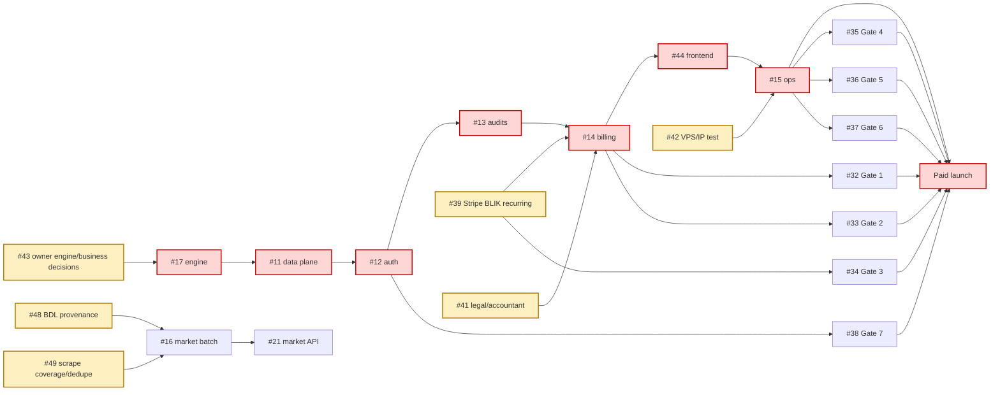

# Roadmap — greenfield rebuild to paid launch

**Planning baseline:** 2026-10-11. **Status:** plan, not an implementation commitment.
`[C]` = confirmed by the cited repository file or GitHub issue; `[I]` = planning inference.
Estimates are **estimates**, in agent-hours unless stated otherwise; they assume one capable agent per
ticket, prompt human review where named, and no upstream/vendor outage. They exclude owner wait time.

## Guardrails and operating rule

- [C] This is a new production implementation; the Otodom POC is read-only requirements and defect
  evidence, never a code, fixture, corpus, or data source (ADR 0001; `.agent/rules/poc-reference.md`).
- [C] Phase 1 is backend only. Blueprint §4.8 order is 1 → 2 → 3 → 4 → 5 → 7 → 8;
  frontend step 6 is Phase 2. Do not start the next numbered step with its predecessor red.
- [C] `invariants` and `migrations` CI are intentionally red until their real tests exist; do not stub
  them (CONTEXT §8). The M2 PR enables both variables and restores both checks on `staging` only after
  all four invariants plus migration tests are green.
- [I] “Done” below means merged to `staging` with required checks green; a paid launch additionally
  needs M9 evidence and a human-approved promotion to `main`.

## Milestones

### M0 — decisions and launch dependencies started

**Goal:** remove irreversible design ambiguity and start external long poles. **Estimate:** 1–2 agent-days
for ADR/planning work; owner/vendor elapsed time unknown. **Issues:** #31, #39, #40, #41, #42, #43, #47.

- [C] First `agent` label: **#31** after #43 decides library pins; #39–#43 are owner-only except #31.
  Human review: owner decisions, legal/accountant evidence, VPS/account access. Risk: waiting for BLIK,
  legal, tax, VPS, or an engine spec delays the critical path (Blueprint §5).
- [C] Exit evidence: ADRs in #31; #43 answers engine/VAT/free-tier/pin decisions; BLIK request submitted
  (#39); legal and Fakturownia/KSeF trial initiated (#41); VPS/IP test plan and purchase window recorded
  (#42); external accounts provisioned (#40). No CI switch yet.
- [C] Unblocks M1 (#17), M2 pins, M5 billing, and M7 infrastructure. #39, #41, #42 remain parallel
  long poles, not reasons to delay unrelated code.

### M1 — engine contract, specified before code

**Goal:** a from-scratch, typed deterministic engine boundary. **Estimate:** 3–6 agent-days after #43.
**Issue:** #17.

- [C] First `agent` label: **#17**, only after the owner closes its specification questions below. Human
  review: owner validates the written financial contract; no POC formula transcription. Risk: wrong
  financial semantics are expensive to reverse (ADR 0001; CONTEXT §9).
- [C] Exit evidence: `test_invariant_rent_is_not_a_deal`, `test_invariant_admin_fee_is_opex`, and
  `test_invariant_deterministic_math` pass; native `ContextRepository`/`ProgressSink`, Decimal money,
  fractional-ownership rejection and LLM ±15% clamp are tested (#17; Blueprint §2/§4.6).
- [I] CI: leave `ENABLE_INVARIANTS_JOB` off until M2 supplies the fourth data-plane invariant; record
  the three passing tests in the PR. Unlocks M2.

### M2 — durable data plane and shared platform primitives

**Goal:** make state, migrations, errors, ledger and developer bootstrap real. **Estimate:** 8–14 agent-days.
**Issues:** #11, #18, #19, #29.

- [C] Serial core: #11 → #19; #18 and #29 may run concurrently after #11’s contracts are stable, in
  separate agent runs. First `agent` label: **#11**; #19 needs human review (money/ledger).
- [C] Exit evidence: Postgres 17/Testcontainers, Alembic baseline, Procrastinate schema, named
  `test_invariant_asking_is_not_deed`, `tests/migrations`, squawk, RFC 9457 problem-shape and readiness
  tests; ledger property/concurrency tests (#11, #18, #19; Blueprint §3/§4.6).
- [C] CI: in the last green M2 PR set `ENABLE_INVARIANTS_JOB=true` and `ENABLE_MIGRATIONS_JOB=true`,
  then restore both as required `staging` checks (PRE-DEPLOYMENT §1). This requires human review of
  repo settings; do not edit rulesets/workflows in this roadmap PR. Unlocks M3.

### M3 — identity and tenancy

**Goal:** secure Google-first and magic-link access, with tenant boundaries. **Estimate:** 4–7 agent-days.
**Issues:** #12, #20.

- [C] Serial: #12 → #20; first `agent` label **#12**. Human review required for auth/session changes.
  Risk: token verification, account collision and cross-tenant disclosure (Blueprint §2, §6 gate 7).
- [C] Exit evidence: Google-token validation/unverified rejection, single-use/rate-limited magic link,
  Origin check, session revocation, 404-not-403 tenant isolation, admin-adjustment idempotency (#12/#20).
  CI stays with M2 switches enabled. Unlocks M4 and later gate #38.

### M4 — audited analysis pipeline

**Goal:** bounded, recoverable user audits with progress and controlled external calls. **Estimate:** 12–20
agent-days. **Issues:** #13, #22, #23, #24, #25, #28, #30.

- [C] Serial integration: #22/#23/#24 → #13 → #25; #28 and #30 can run in parallel once their API/model
  contracts settle. First `agent` label **#22** (then #23/#24); #13 has human review (ledger).
- [C] Exit evidence: quota race/release, duplicate-active-audit, timeout-kills-child, worker-death
  recovery, SSE resume/burst, offline client fakes, throttle/circuit-breaker, image/budget limits and
  GDPR retention/erasure tests (#13, #22–#25, #30; Blueprint §2, §4.5–§4.7, §6).
- [C] Risk: Otodom schema/anti-bot failure, OpenRouter cost/availability, images/OOM, and POC defects
  (synchronous work, filesystem state, lock-held rate limit) are designed out through Postgres state,
  child deadline, external-client fakes and short transactions (CONTEXT §5; POC audit §2–§3.2).
  CI: M2 switches remain required. Unlocks M5.

### M5 — billing, tax outbox and entitlements

**Goal:** safely sell card/BLIK access and issue invoices without duplicate effects. **Estimate:** 10–18
agent-days plus vendor trial time. **Issues:** #14, #26, #27, #32, #33, #39.

- [C] Serial: #14 builds the state machine; #26/#27 follow its payment contracts; #32/#33 are release
  evidence after implementation. #39 is an owner long pole and runs now. First `agent` label **#14**;
  every money/tax/webhook PR requires human review.
- [C] Exit evidence: raw-body signature tests, adverse webhook ordering, pass-extension concurrency,
  fail-closed entitlement, test-clock run, VAT outbox idempotency and Fakturownia fake tests (#14/#26/#27;
  Blueprint §3, §4.5c, §6). #32 proves the provider trial separately.
- [C] Risk: BLIK recurring activation/bank support (#39), Fakturownia API-created-invoice KSeF behaviour
  (#32), and accountant decisions (#41). CI: existing required checks plus billing concurrency evidence;
  no paid release until gates 1–3 pass. Unlocks Phase 2 and M7.

### M6 — Phase 2 frontend boundary

**Goal:** a SPA that renders API truth and never recomputes finance. **Estimate:** 6–10 agent-days.
**Issue:** #44 (with #28 completed in M4).

- [C] First `agent` label **#44**; human review for BLIK disclosure/copy and accessibility. Risk: reintroducing
  dual financial logic, a POC defect (POC audit §2). Exit: generated client type-check, SSE reconnect,
  402/paywall state, and `test_no_frontend_finance` pass (Blueprint §2; #28/#44).
- [C] CI: M2 switches remain required; staging’s frontend/type checks become release-required. Unlocks
  production user journey validation, but M7/M8 can proceed without frontend file conflicts.

### M7 — production operations and recovery

**Goal:** a bounded single-VPS service that can be monitored and restored. **Estimate:** 6–10 agent-days
plus owner provisioning. **Issues:** #15, #35, #36, #37, #40, #42.

- [C] First `agent` label **#15** after #42 supplies a safe VPS; owner-only #40/#42 run in parallel.
  Human review: production access, deployment and restore evidence. Exit: compose resource limits,
  Caddy controls, backup/monitor runbooks, VPS IP result, and gates 4–6 evidence (#15, #35–#37).
- [C] Risk: blocked datacenter IP, OOM, exhausted Postgres connections, single-host loss. Mitigate with
  `UPSTREAM_BLOCKED` credit release/proxy plan, measured cgroup peak, under-70 connection gate and timed
  WAL-G PITR (Blueprint §5–§6; L-002). CI: M2 switches plus staging required checks; production gates
  are evidence, not CI substitutions. Unlocks M9.

### M8 — fresh market data and screener

**Goal:** reproducible market/ranking jobs without POC corpus import. **Estimate:** 10–18 agent-days.
**Issues:** #16, #21, #48, #49.

- [C] Serial design: #48/#49 specification gates → #16 batch importers → #21 API routes. Per the
  gap-ticket rule, #48/#49 never receive `agent`; first eligible `agent` label is **#16** after owner
  validation. #49 may run in parallel with #48; #16 and #21 are then serial. Human review: data
  provenance and legal tags.
- [C] Exit: separate asking/deed typed sidecars, checkpointed fresh imports, coverage/quality manifests,
  withheld rankings for incomplete cohorts, large-city partition/dedupe evidence, free-tier/flag tests
  (#16/#21/#48/#49; Blueprint §2/§4.8; GUS POC README and verification, read-only).
- [I] Risk: GUS quota/metric gaps, partial cohort rankings, Moniter HTML drift, Otodom page-depth bias.
  Mitigate with source contracts, resume/checkpoints, validation alerts and publication withholding; never
  merge asking with deed data. CI: existing checks; add these offline contract fixtures before a scheduler.
  Unlocks full market launch scope, but core paid audit launch can be assessed independently if owner
  explicitly narrows the product scope.

### M9 — launch evidence and paid release

**Goal:** every release gate and pre-deployment section has dated evidence. **Estimate:** 3–6 agent-days
plus owner/legal/vendor elapsed time. **Issues:** #32–#38, #40–#42.

- [C] No first agent ticket: gate work starts in its owning milestone. Owner-only: #40–#42; human
  approval: all release evidence and `staging` → `main` promotion. Exit: gates 1–7 pass (#32–#38),
  PRE-DEPLOYMENT §§0–7 complete, limitations accepted/mitigated, and one approved promotion PR.
- [C] CI: all staging required checks are green, including enabled invariants/migrations. Release is blocked
  by any red predecessor, active unaccepted limitation, or missing owner evidence.

## Dependencies and critical path

[C] Red nodes are the critical implementation path; amber nodes are long poles. #39, #41, #42,
#17/#43 and the Fakturownia/KSeF trial in #32 are launch-critical evidence paths (Blueprint §3/§5/§6).

## Owner decisions — deadline and required answer

| By | Decision / blocker | Required answer |
|---|---|---|
| Before #17 / M1 | **Engine specification (#43)** | Define cash-flow horizon/timing, purchase/transaction/operating/CAPEX categories and rounding; rental tax regime, rates/thresholds, VAT/non-residential/PCC treatment; target return and exact **Max Bid** definition; grade names, cut-offs and insufficient-data policy; defaults/scenario inputs and which LLM adjustments are permitted. [C] The POC behaviour to confirm (not copy) includes a 10-year valuation, whole-unit-only returns, separate market/income terminal views, purchase negotiation, Polish rental-tax treatment, 5/10/15/20-year horizons and a Python grade (POC `apps/ARCHITECTURE.md`, `PIPELINE.md`). |
| Before #11 / M2 | Library decisions (#43/#31) | SQLAlchemy supported minor and Stripe SDK/API-version pin. [C] |
| Start now; required M5/M9 | Stripe BLIK (#39) | Request/obtain both BLIK capabilities; confirm eligible-bank fallback to the 30-day pass. [C] |
| Before #14/#26; evidence M9 | Legal/accountant/Fakturownia (#41/#32) | Scraping/image risk decision; privacy/processor posture; VAT display, B2C/B2B and KSeF treatment; prove API-created invoice delivery on a Fakturownia trial. [C] |
| Before price creation/M5 | Product choices (#43) | 100 zł gross/net presentation, free tier, initial allowance (placeholder until measured COGS). [C] |
| Before M7 | Infrastructure (#40/#42) | Poland VPS, OVH IP reachability/proxy fallback, domain/OAuth/R2/Resend/Sentry ownership. [C] |
| Before #48/M8 | Market scope/data reuse | Approve only licensed, provenance-preserving fresh inputs; decide which reviewed GUS metrics belong in product outputs. Do not import parsed web artifacts merely to bypass GUS API limits. [I] |

## Risks and mitigations

| Risk | Plan mitigation | Trace |
|---|---|---|
| Commercial scraping/legal exposure | Counsel review, tags/kill switches, private snapshots, launch block | [C] Blueprint §5; L-001; #41 |
| Otodom block/schema drift | Circuit breaker, credit release, fixture/schema contract test, VPS test/proxy | [C] Blueprint §2/§5; L-002; #22/#42 |
| Money/model error | Owner spec first; Decimal, property/concurrency and four invariant tests | [C] ADR 0001; CONTEXT §3/§5; #17/#19 |
| BLIK/KSeF failure | Start activation and Fakturownia trial early; idempotent outbox, gates 1–3 | [C] Blueprint §3/§6; #26/#32/#39 |
| Memory/connection/recovery failure | Child limit, image caps, connection/load and PITR gates | [C] Blueprint §6; #35–#37 |
| Data quality/ranking bias | Separate price bases; source contracts, coverage manifest, checkpoints, withhold partial rankings | [C] CONTEXT §3; #48/#49; GUS POC verification (read-only) |
| POC anti-pattern recurrence | Postgres not files/SQLite; no request-path network inside engine; queue/deadline/SSE | [C] ADR 0001; CONTEXT §5; POC audit §2–§3 |

## Launch readiness map

| PRE-DEPLOYMENT section | Milestone / release evidence |
|---|---|
| §0 visibility | M9 owner confirmation; #40 |
| §1 code and tests | M1–M6; enabled CI switches at M2; #11/#17/#28 |
| §2 gates 1–7 | M5: #32–#34; M7: #35–#37; M3: #38 |
| §3 security | M2–M4, M7; #12/#13/#15/#22 |
| §4 legal, GDPR, tax | M4–M5 and M9; #26/#30/#41 |
| §5 billing and product | M5/M9; #14/#24/#39/#43 |
| §6 infrastructure/operations | M7/M9; #15/#25/#37/#40/#42 |
| §7 launch day | M9: human-approved promotion, smoke/refund/replay/SSE proof |

## Planning notes

- [C] Parallel work is only within the explicit lanes above; serial arrows are contracts or §4.8 order.
  Keep each ticket in a separate agent run when its files are disjoint; integrate only after predecessor
  checks are green.
- [C] Gaps added by this plan are #48 (BDL provenance/completeness) and #49 (city coverage/deduplication).
  They carry `phase-1`, not `agent`, and are traced in `docs/BACKLOG.md`.
